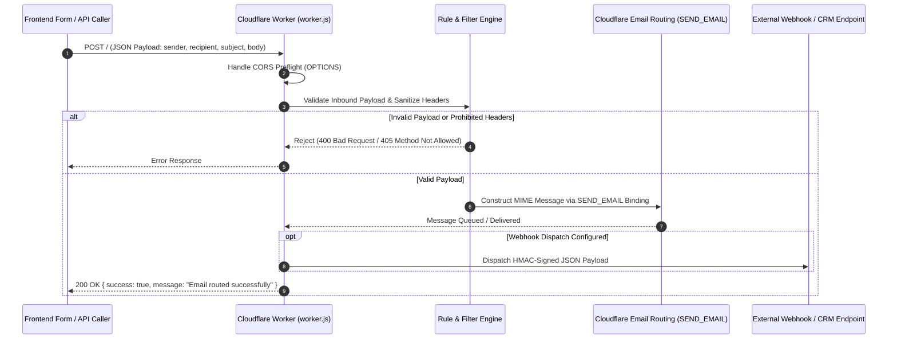

<div align="center">
  <h1>email-router-api</h1>
  <p>Cloudflare Worker edge gateway to parse, filter, and route inbound and outbound emails to webhooks and database queues.</p>

  <p>
    <a href="https://github.com/itsgoharrehman/email-router-api/releases"></a>
    <a href="LICENSE"></a>
    
    
    <a href="https://github.com/itsgoharrehman/email-router-api/stargazers"></a>
    <a href="https://github.com/itsgoharrehman/email-router-api/issues"></a>
  </p>
</div>

---

## Overview

email-router-api is a high-performance serverless email routing and webhook gateway deployed on Cloudflare Workers. It intercepts inbound contact form payloads, parses structured message streams, validates recipient routing rules, and dispatches authenticated outgoing emails using Cloudflare's native `send_email` bindings and HTTP webhooks.

By executing at the edge, the router delivers sub-50ms latency, zero cold starts, and built-in protection against email header injection and spam flood attacks.

## Architecture and Edge Routing Flow



## Core Capabilities

### 1. Cloudflare Workers Edge Delivery
* Deploys directly to Cloudflare's global edge network using Wrangler.
* Utilizes native `[[send_email]]` bindings for direct, zero-dependency SMTP-less message routing.

### 2. Header Injection & Abuse Mitigation
* Sanitizes inbound subject, sender, and recipient fields against CRLF (`\r\n`) header injection attacks.
* Implements origin whitelisting and CORS preflight handling.

### 3. Structured MIME Message Construction
* Dynamically constructs RFC 5322 compliant email messages with text and HTML alternative parts.
* Encodes headers and attachments cleanly without external dependencies.

## Prerequisites

* [Cloudflare Account](https://cloudflare.com/) with an active domain configured for Email Routing.
* Node.js 18+ and [Wrangler CLI](https://developers.cloudflare.com/workers/wrangler/).

## Installation and Quickstart

### 1. Clone the Repository

```bash
git clone https://github.com/itsgoharrehman/email-router-api.git
cd email-router-api
```

### 2. Install Dependencies

```bash
npm install
```

### 3. Configure `wrangler.toml`

Ensure your Cloudflare `wrangler.toml` declares the email routing binding:

```toml
name = "email-router-api"
main = "worker.js"
compatibility_date = "2024-03-03"

[[send_email]]
name = "SEND_EMAIL"
```

### 4. Local Development

```bash
npm run dev
```

### 5. Deploy to Cloudflare Edge

```bash
npm run deploy
```

## API Specification

### Endpoint: `POST /`

Dispatches an email based on structured JSON input.

#### Request Headers
```http
POST / HTTP/1.1
Host: your-worker.your-subdomain.workers.dev
Content-Type: application/json
```

#### Request Payload
```json
{
  "name": "Jane Doe",
  "email": "jane@example.com",
  "subject": "Inquiry Regarding Services",
  "message": "Hello, I would like to schedule a consultation."
}
```

#### Response
```json
{
  "success": true,
  "message": "Message sent successfully"
}
```

## Security Considerations

* **CRLF Injection Prevention**: Input fields are stripped of newline characters (`\r`, `\n`) before header insertion to prevent mail relay hijacking.
* **Binding Isolation**: Uses Cloudflare internal `SEND_EMAIL` bindings, eliminating exposed SMTP credentials in configuration files.
* **Origin Whitelisting**: CORS headers can be locked to trusted frontend domains to prevent third-party form spam.

## License and Security Contact

This project is licensed under the [MIT License](LICENSE).

For security reports, please review [SECURITY.md](SECURITY.md) or contact `goharrehmanfsd260@gmail.com`.